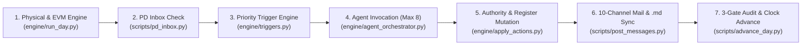

# ☀️ HELIOS 100MW Solar PV + 33/220kV GSS — Autonomous Multi-Agent EPC Simulation

[](#)
[](#)
[](#)
[](00_Project_Overview/03_Workforce_Directory/WORKFORCE_DIRECTORY.md)
[-D9772A?style=flat-square)](scripts/sim_clock.json)

---

## 1. Executive Project Overview

**HELIOS** is a deterministic, event-driven **100MW Solar Photovoltaic Power Plant & 33/220kV Grid Substation Turnkey EPC Simulation** located in the **Bukhara Region, Republic of Uzbekistan**, governed strictly under the **FIDIC Conditions of Contract for Plant and Design-Build (Yellow Book, 1999 First Edition)**.

Unlike free-form multi-agent chat experiments, HELIOS operates on a **Closed-Loop Deterministic Physics & Earned Value Management (EVM) Engine** coupled with a **65-member Organization Hierarchy** (**1 Human Project Director — Danesh Selwal (`PD-00`)** + **64 specialized AI Agent Personas** across 12 internal and external departments).

| Parameter | Specification |
| :--- | :--- |
| **Project Title** | HELIOS 100MWp / 100MWac Bifacial Tracker Solar PV + 33/220kV Air/GIS Grid Substation |
| **Location** | Bukhara Region, Republic of Uzbekistan (Arid Desert / Kyzylkum Fringe; SanPiN >42°C summer curtailment & winter frost) |
| **Governing Contract** | FIDIC Yellow Book 1999 — Fixed Lump Sum Turnkey EPC (`BAC = USD 85,000,000.00`) |
| **Baseline Duration (`HEL.00`)** | **18 Months** (`504 Simulation Days` using standardized `28-day` lunar/control months) |
| **Delay Liquidated Damages** | `0.10%` of Contract Price per day (`USD 85,000/day`), capped at `10%` (`USD 8,500,000`) |
| **Performance Guarantee** | Guaranteed Performance Ratio `PR ≥ 81.5%` (IEC 61724-1 Class A telemetry) |
| **Master Critical Path** | **125MVA 220/33kV Main Power Transformer (`MPT`) & 220kV GSS Substation** (`0 days Total Float`) |
| **PV Array Field Path** | `15,400` Driven Steel Piles, `2,200` 1P Single-Axis Trackers, `181,818` TOPCon Bifacial Modules (`+45 days Float`) |
| **Current Simulation State** | **Clean Start Position — Sim Day `001` (`2026-10-06`, Month 1, Week 1, Day 1 — LNTP Kickoff)** |

---

## 2. Visual Organization Chart & 65-Member Workforce Directory

Every member of the project—from the Human Project Director (`Danesh Selwal`) and EPC Project Manager (`ATLAS`) down to field QC inspectors, turnkey subcontractors, equipment vendors, and the Grid Utility (`GRIDMASTER`)—has a dedicated **Persona Instruction File**, **Delegated Financial & Operational Authority Matrix**, **Portrait Avatar**, and **Individual Personnel Dossier**.

- 📄 **Single-Page Master Organization Chart (PDF, Rev 2.0)**:
  - [`00_Project_Overview/HELIOS_OC_Single_Page.pdf`](00_Project_Overview/HELIOS_OC_Single_Page.pdf) *(All 64 AI Agents + 1 Human PD built & illustrated; `0` TBI pending)*
- 👥 **Complete Visual Workforce Directory (Photos, Profiles, Roles & Authority Limits)**:
  - [`00_Project_Overview/03_Workforce_Directory/WORKFORCE_DIRECTORY.md`](00_Project_Overview/03_Workforce_Directory/WORKFORCE_DIRECTORY.md)
  - Individual Portrait Photos (`.svg` & `.png`): [`00_Project_Overview/03_Workforce_Directory/avatars/`](00_Project_Overview/03_Workforce_Directory/avatars/)
  - Individual Personnel Dossiers (`65` files): [`00_Project_Overview/03_Workforce_Directory/profiles/`](00_Project_Overview/03_Workforce_Directory/profiles/)
- 📊 **Executive Command Suite (Excel & PowerPoint)**:
  - 7-Tab Master Control Workbook: [`00_Project_Overview/01_Executive_Command_Suite/HELIOS_EPC_Master_Control_Workbook.xlsx`](00_Project_Overview/01_Executive_Command_Suite/HELIOS_EPC_Master_Control_Workbook.xlsx)
  - 10-Slide Executive Command Deck: [`00_Project_Overview/01_Executive_Command_Suite/HELIOS_EPC_Executive_Command_Deck.pptx`](00_Project_Overview/01_Executive_Command_Suite/HELIOS_EPC_Executive_Command_Deck.pptx)

### Departmental Breakdown (64 AI Agents + 1 Human PD)

| Dept Code | Department Name | Head / Lead | Roster Count | Personnel & Agent Codes | Repository Folder |
| :--- | :--- | :--- | :---: | :--- | :--- |
| **`PD`** | **Executive Project Directorate** | **Danesh Selwal** | **1** | `DANESH` (`PD-00` — Human-in-the-Loop Project Director) | [`00_Project_Overview/`](00_Project_Overview/) |
| **`PMO`** | **Project Management Office** | **`ATLAS`** | **3** | `ATLAS` (`PM-01`), `NEXUS` (`PM-02`), `HERALD` (`PM-03`) | [`00_Project_Overview/ATLAS_ProjectManagement/`](00_Project_Overview/ATLAS_ProjectManagement/) |
| **`PLN`** | **Planning, Schedule & Cost Controls** | **`KRONOS`** | **5** | `KRONOS` (`PL-01`), `VECTOR` (`PL-02`), `WATT` (`PL-03`), `SIGMA` (`PL-04`), `LEDGER` (`PL-05`) | [`01_Planning_Controls/`](01_Planning_Controls/) |
| **`ENG`** | **Engineering & Design** | **`ARCHON`** | **8** | `ARCHON` (`EN-01`), `TERRA` (`EN-02`), `MERIDIAN` (`EN-03`), `SOLARIS` (`EN-04`), `AMPERE` (`EN-05`), `VOLTA` (`EN-06`), `CIPHER` (`EN-07`), `NEXGEN` (`EN-08`) | [`02_Engineering_Design/`](02_Engineering_Design/) |
| **`SCM`** | **Supply Chain, Procurement & Logistics** | **`CONVOY`** | **7** | `CONVOY` (`SC-01`), `FORGE` (`SC-02`), `DEPOT` (`SC-03`), `VENDOR` (`SC-04`), `TRACER` (`SC-05`), `ROUTE` (`SC-06`), `VAULT` (`SC-07`) | [`03_SCM/`](03_SCM/) |
| **`CON`** | **Site Construction Management** | **`RAMPART`** | **8** | `RAMPART` (`CO-01`), `BASTION` (`CO-02`), `STRATUM` (`CO-03`), `CONDUIT` (`CO-04`), `ARCLINE` (`CO-05`), `FORTRESS` (`CO-06`), `SWITCHMAN` (`CO-07`), `PRISM` (`CO-08`) | [`04_Construction/`](04_Construction/) |
| **`QAQ`** | **Quality Assurance & Quality Control** | **`SENTINEL`** | **5** | `SENTINEL` (`QA-01`), `PLUMBLINE` (`QA-02`), `TORQUE` (`QA-03`), `OHMMETER` (`QA-04`), `DOSSIER` (`QA-05`) | [`05_Quality/`](05_Quality/) |
| **`EHS`** | **Health, Safety, Environment & SanPiN** | **`AEGIS`** | **4** | `AEGIS` (`EH-01`), `GUARDIAN` (`EH-02`), `WARDEN` (`EH-03`), `VERDANT` (`EH-04`) | [`06_EHS/`](06_EHS/) |
| **`COM`** | **FIDIC Contracts, Claims & Billing** | **`COUNSEL`** | **5** | `COUNSEL` (`CC-01`), `CLAIMS` (`CC-02`), `INVOICE` (`CC-03`), `CHECKER` (`CC-04`), `LEDGE` (`CC-05`) | [`07_Contracts/`](07_Contracts/) |
| **`TNC`** | **Testing, Commissioning & Grid** | **`IGNITE`** | **4** | `IGNITE` (`TC-01`), `SPARK` (`TC-02`), `RELAY` (`TC-03`), `GRIDLOCK` (`TC-04`) | [`08_TC/`](08_TC/) |
| **`ADM`** | **Site Administration, Permits & Finance** | **`SUMMIT`** | **3** | `SUMMIT` (`AD-01`), `LEDGER2` (`AD-02`), `PERMIT` (`AD-03`) | [`09_Admin/`](09_Admin/) |
| **`SUB`** | **Turnkey Site Subcontractors** | *Supervised by `RAMPART`* | **4** | `GROUNDWORK` (`SM-01`), `EREKTOR` (`SM-02`), `ELECTRA` (`SM-03`), `GRIDCON` (`SM-04`) | [`10_Subcontractors/`](10_Subcontractors/) |
| **`EXT`** | **External Counterparties & Authorities** | *Interfaces w/ `PD`/`ATLAS`* | **8** | `PATRON` (`EX-01`), `AUDITOR` (`EX-02`), `GRIDMASTER` (`EX-03`), `LUMINOS` (`EX-04`), `INVERSA` (`EX-05`), `POWERTRANS` (`EX-06`), `INSPECTOR` (`EX-07`), `CERTIFIER` (`EX-08`) | [`16_External_Parties/`](16_External_Parties/) |

---

## 3. How the Simulation Works (Closed-Loop Daily Lifecycle)

Every simulation day is executed deterministically by [`engine/agent_orchestrator.py`](engine/agent_orchestrator.py) through a **7-stage closed-loop pipeline**:



1. **Stage 1 — Deterministic Site Reality & EVM Calculation ([`engine/run_day.py`](engine/run_day.py), [`engine/site_reality.py`](engine/site_reality.py), [`engine/evm.py`](engine/evm.py))**:
   - Computes daily Bukhara weather (temperature, wind speed, productivity factor), active risk events from [`engine/events.json`](engine/events.json), physical workfront progression (`delivered`, `installed`, `qc_accepted`), and true Earned Value metrics (`BCWS`, `BCWP`, `ACWP`, `SPI`, `CPI`).
   - **Strict EVM Rule**: Advance payments and LCs are cash flow, **never** `ACWP`. Earned Value (`BCWP`) accrues **only** on QC-accepted physical work, certified engineering deliverables, or achieved procurement milestones defined in [`state/baseline.json`](state/baseline.json).
2. **Stage 2 — Human-in-the-Loop PD Inbox ([`scripts/pd_inbox.py`](scripts/pd_inbox.py))**:
   - Scans **Channel `CH-01` (GitHub Issue `#31`)** for direct executive commands from **Danesh (`PD`)**, such as `INJECT EVT-001` or `DECIDE <MSG-ID> APPROVE|REJECT`.
3. **Stage 3 — Priority-Scored Trigger Evaluation ([`engine/triggers.py`](engine/triggers.py))**:
   - Evaluates all 64 agents against 5 trigger conditions:
     - **(a)** Danesh direct instruction (`Priority 100`)
     - **(b)** Pre-planted event in [`engine/events.json`](engine/events.json) hitting the agent (`Priority 80`)
     - **(c)** Threshold breach (`SPI < 0.95`, `CPI < 0.95`, critical path float `< 15d`, PO drop-dead `< 7d`, FIDIC 28-day notice bar at Day 20) (`Priority 60–65`)
     - **(d)** Open incoming messages in [`11_Shared_Registers/Communication_Log.csv`](11_Shared_Registers/Communication_Log.csv) (`Priority 50`)
     - **(e)** Scheduled daily duty inside the agent's mobilization window (`ATLAS` PD brief, `SIGMA` DPR compilation) (`Priority 30–35`)
   - Enforces a hard cap of **maximum 8 invoked agents per simulation day**; remaining candidates are logged as `deferred` in `state/day_NNN_invocations.json`.
4. **Stage 4 — Domain-Filtered Agent Execution ([`engine/agent_orchestrator.py`](engine/agent_orchestrator.py))**:
   - Each invoked agent reads its own persona file, its extracted authority limits from [`engine/authority_matrix.json`](engine/authority_matrix.json), its open inbox items, and a department-tailored state brief. Agents never invent quantities; they respond strictly with structured JSON (`{"messages": [...], "actions": [...]}`).
5. **Stage 5 — Authority Validation & Automatic Register Mutation ([`engine/apply_actions.py`](engine/apply_actions.py))**:
   - Every proposed agent action is validated against [`engine/authority_matrix.json`](engine/authority_matrix.json) (checking standalone financial limits, prohibitions, and physical prerequisites such as IFC release and material delivery).
   - **Accepted actions** automatically update [`state/project_state.json`](state/project_state.json) and append formatted rows directly into the governing Markdown registers (`RFI_TQ_FDC_Register.md`, `ITP_Hold_Point_Register.md`, `Delay_Event_Log.md`, `FIDIC_Notice_Log.md`, `NCR_Register.md`, `PTW_Log.md`, `DPR_Day{NNN}.md`).
   - **Rejected actions** are blocked and queued to `state/inbox_queue/` for next-day escalation.
6. **Stage 6 — 10-Channel Coded Mail Routing & Dual `.md` Archiving ([`scripts/post_messages.py`](scripts/post_messages.py))**:
   - Assigns a unique Coded Mail ID (`HEL-D{DDD}-{FROM_DEPT}-{TO_DEPT}-{WORK_CODE}-{TYPE}-{NNNN}`), posts to the corresponding GitHub Issue Channel (`#31`–`#40`), marks replied-to parent messages as `answered` in [`11_Shared_Registers/Communication_Log.csv`](11_Shared_Registers/Communication_Log.csv), and writes `.md` copies into both `11_Shared_Registers/Communications_Archive/Day_NNN/` and the sender/recipient departmental `Communications_<DEPT>.md` files.
7. **Stage 7 — Three-Gate Verification & Git Identity Enforcement ([`scripts/advance_day.py`](scripts/advance_day.py), [`engine/git_identity.py`](engine/git_identity.py))**:
   - The simulation clock **refuses to advance** to `Day N+1` unless all three gates pass:
     - **Gate (i)**: `DPR_Day{NNN}.md` is committed in Git by `SIGMA`, `Delay_Event_Log.md` has a `KRONOS` validation entry for `Day N`, and `ATLAS` has logged the daily PD briefing.
     - **Gate (ii)**: Every communication row for `Day N` carries a valid `HEL-D{DDD}-...` Msg-ID.
     - **Gate (iii)**: Zero `HIGH` or `CRITICAL` priority messages remain `open` (unanswered) for more than `1` simulation day.
   - All commits are signed with the owning agent's Git identity via [`engine/git_identity.py`](engine/git_identity.py) and verified on push by `.git/hooks/pre-push` against [`scripts/path_owners.json`](scripts/path_owners.json).

---

## 4. 10-Channel GitHub Issue Board & Coded Mail Architecture

Every message uses the standardized **Coded Mail ID**:
`HEL-D{DDD}-{FROM_DEPT}-{TO_DEPT}-{WORK_CODE}-{TYPE}-{NNNN}` (e.g., `HEL-D001-PMO-PLN-MOB-INS-0001`).

| Channel | GitHub Issue | Channel Scope & Participating Departments | Departmental `.md` Mailbox Mirror |
| :--- | :---: | :--- | :--- |
| **`CH-01`** | [`Issue #31`](https://github.com/DaneshSelwal/HELIOS-EPC-Simulation/issues/31) | **`[CH-01 \| PD-EXEC]`** Executive PD Briefings, Directives & Event Injections (`DANESH <-> ATLAS`) | [`00_Project_Overview/Communications_PMO.md`](00_Project_Overview/Communications_PMO.md) |
| **`CH-02`** | [`Issue #32`](https://github.com/DaneshSelwal/HELIOS-EPC-Simulation/issues/32) | **`[CH-02 \| PMO-PLN]`** Master Schedule, EVM Controls, DPR/WPR/MPR & Action Chasers (`PMO / PLN`) | [`01_Planning_Controls/Communications_PLN.md`](01_Planning_Controls/Communications_PLN.md) |
| **`CH-03`** | [`Issue #33`](https://github.com/DaneshSelwal/HELIOS-EPC-Simulation/issues/33) | **`[CH-03 \| ENG-DES]`** Engineering Design, Submittals, RFIs, FDCs & Technical Queries (`ENG`) | [`02_Engineering_Design/Communications_ENG.md`](02_Engineering_Design/Communications_ENG.md) |
| **`CH-04`** | [`Issue #34`](https://github.com/DaneshSelwal/HELIOS-EPC-Simulation/issues/34) | **`[CH-04 \| SCM-LOG]`** Procurement, TBE/CBE, Factory Expediting, Khorgos Customs & Stores (`SCM`) | [`03_SCM/Communications_SCM.md`](03_SCM/Communications_SCM.md) |
| **`CH-05`** | [`Issue #35`](https://github.com/DaneshSelwal/HELIOS-EPC-Simulation/issues/35) | **`[CH-05 \| CON-CIV]`** Civil, Earthworks, Piling, Tracker & Module Field Execution (`CON / SUB`) | [`04_Construction/Communications_CON.md`](04_Construction/Communications_CON.md) |
| **`CH-06`** | [`Issue #36`](https://github.com/DaneshSelwal/HELIOS-EPC-Simulation/issues/36) | **`[CH-06 \| CON-ELE]`** DC/MV Electrical, PCS Stations & 220kV GSS Substation Construction (`CON / SUB`) | [`04_Construction/Communications_CON.md`](04_Construction/Communications_CON.md) |
| **`CH-07`** | [`Issue #37`](https://github.com/DaneshSelwal/HELIOS-EPC-Simulation/issues/37) | **`[CH-07 \| QAQ-NCR]`** Quality Assurance, ITP Hold Points, Lab Cubes, EL Tests & NCRs (`QAQ`) | [`05_Quality/Communications_QAQ.md`](05_Quality/Communications_QAQ.md) |
| **`CH-08`** | [`Issue #38`](https://github.com/DaneshSelwal/HELIOS-EPC-Simulation/issues/38) | **`[CH-08 \| EHS-ADM]`** HSE Permits-to-Work, SanPiN Thermal Controls, Camp & Local Permits (`EHS / ADM`) | [`06_EHS/Communications_EHS.md`](06_EHS/Communications_EHS.md) & [`09_Admin/Communications_ADM.md`](09_Admin/Communications_ADM.md) |
| **`CH-09`** | [`Issue #39`](https://github.com/DaneshSelwal/HELIOS-EPC-Simulation/issues/39) | **`[CH-09 \| COM-FID]`** FIDIC Sub-Clause 20.1 Notices, Claims, VOs, IPCs & Sub-Billing (`COM`) | [`07_Contracts/Communications_COM.md`](07_Contracts/Communications_COM.md) |
| **`CH-10`** | [`Issue #40`](https://github.com/DaneshSelwal/HELIOS-EPC-Simulation/issues/40) | **`[CH-10 \| TNC-GRD]`** Testing, Pre-Commissioning, SCADA P2P, Grid Code & Energization (`TNC / EXT`) | [`08_TC/Communications_TNC.md`](08_TC/Communications_TNC.md) |

---

## 5. Canonical Repository Directory Tree

```text
HELIOS_EPC/
├── README.md                                            # Master Project Architecture, Governance & Operations Guide
├── 00_Project_Overview/                                 # [PMO] Executive Command, Org Chart & Workforce Directory
│   ├── HELIOS_OC_Single_Page.pdf                        # Master Single-Page Organization Chart (Rev 2.0 — All 65 Built)
│   ├── HELIOS_EPC_Workforce.xlsx                        # 64-Agent Master Workforce Roster & Activity Windows
│   ├── Communications_PMO.md                            # PMO Coded Mail Mirror (CH-01 & CH-02)
│   ├── ATLAS_ProjectManagement/                         # PMO Agent Personas: ATLAS, NEXUS, HERALD
│   ├── 01_Executive_Command_Suite/                      # Executive PPTX Deck, 7-Tab Excel Control Workbook & Master Prompt
│   ├── 02_Department_Research_Briefs/                   # Domain Engineering & FIDIC Research Briefs (DEPT01–DEPT10 PDFs)
│   └── 03_Workforce_Directory/                          # Complete 65-Personnel Visual Roster
│       ├── WORKFORCE_DIRECTORY.md                       # Master Visual Table (Photos, Roles, Limits & Dossier Links)
│       ├── avatars/                                     # 65 SVG + 65 PNG Portrait Photos (DANESH, ATLAS, KRONOS, ...)
│       └── profiles/                                    # 65 Individual Personnel Dossiers (PD-00_DANESH.md .. EX-08_CERTIFIER.md)
├── 01_Planning_Controls/                                # [PLN] KRONOS, SIGMA, VECTOR, WATT, LEDGER + Delay_Event_Log.md
├── 02_Engineering_Design/                               # [ENG] ARCHON, TERRA, MERIDIAN, SOLARIS, AMPERE, VOLTA, CIPHER, NEXGEN
├── 03_SCM/                                              # [SCM] CONVOY, FORGE, DEPOT, VENDOR, TRACER, ROUTE, VAULT
├── 04_Construction/                                     # [CON] RAMPART, BASTION, STRATUM, CONDUIT, ARCLINE, FORTRESS, SWITCHMAN, PRISM
├── 05_Quality/                                          # [QAQ] SENTINEL, PLUMBLINE, TORQUE, OHMMETER, DOSSIER
├── 06_EHS/                                              # [EHS] AEGIS, GUARDIAN, WARDEN, VERDANT
├── 07_Contracts/                                        # [COM] COUNSEL, CLAIMS, INVOICE, CHECKER, LEDGE + Claims & FIDIC Notice Logs
├── 08_TC/                                               # [TNC] IGNITE, SPARK, RELAY, GRIDLOCK
├── 09_Admin/                                            # [ADM] SUMMIT, LEDGER2, PERMIT
├── 10_Subcontractors/                                   # [SUB] GROUNDWORK, EREKTOR, ELECTRA, GRIDCON
├── 11_Shared_Registers/                                 # [ALL] 13 Single-Source-of-Truth Project Registers & Mail Archive
│   ├── Communication_Log.csv                            # Master Coded Communication Log
│   ├── COMM_MATRIX.md                                   # Auto-generated Inter-Department Communication Matrix
│   ├── Communications_Archive/Day_001/                  # Daily Coded Mail Archive & Digest (.md)
│   ├── Action_Tracker.md                                # Cross-Department Action Tracker
│   ├── Billing_Register.md                              # Employer IPC & Subcontractor Billing Register
│   ├── Cost_Control_EVM_Ledger.md                       # Earned Value Management (BCWS/BCWP/ACWP/SPI/CPI) Ledger
│   ├── Delay_Event_Log.md                               # Shared Master Delay Event & Gate (i) Log
│   ├── HELIOS_EPC_Master_Control_Workbook.xlsx          # 7-Tab Master Control Workbook
│   ├── ITP_Hold_Point_Register.md                       # Inspection & Test Plan Hold/Witness Point Register
│   ├── Master_Document_Register_MDR.md                  # Engineering Submittal & IFC Register
│   ├── Material_Receipt_Quarantine_Log_MIRN.md          # Warehouse MIRN & Quarantine Log
│   ├── NCR_Register.md                                  # Quality Non-Conformance Register
│   ├── Procurement_Tracker.md                           # Equipment & BOP Procurement Tracker
│   ├── PTW_Log.md                                       # EHS Permit-to-Work Log
│   ├── RFI_TQ_FDC_Register.md                           # RFI, Technical Query & Field Design Change Register
│   ├── Risk_Register.md                                 # Project Risk Register
│   └── Statutory_Permits_Tracker.md                     # Uzbek Regulatory & Construction Permits Tracker
├── 12_Daily_Reports/DPR/                                # [SIGMA] Daily Progress Reports (DPR_Day001.md ...)
├── 13_Weekly_Reports/                                   # [SIGMA] Weekly Progress Reports (WPR)
├── 14_Monthly_Reports/                                  # [KRONOS] Monthly Progress Reports (MPR)
├── 15_Event_Engine/                                     # [ENGINE] Pre-Planted Event Seed Specifications
├── 16_External_Parties/                                 # [EXT] PATRON, AUDITOR, GRIDMASTER, LUMINOS, INVERSA, POWERTRANS, INSPECTOR, CERTIFIER
├── engine/                                              # Deterministic Python State, EVM, Trigger & Orchestrator Engine
├── scripts/                                             # Operational CLI Tools, Gating Verifiers & Git Ownership Guards
└── state/                                               # Machine-Readable JSON State Snapshots & Channel Mapping
```

---

## 6. Quick-Start Operational Commands

```bash
# 1. Verify all 64 agent authorities from persona files
python3 scripts/build_authority_matrix.py

# 2. Regenerate the Inter-Department Communication Matrix (11_Shared_Registers/COMM_MATRIX.md)
python3 scripts/comm_report.py

# 3. Dry-run Gate (i), Gate (ii), and Gate (iii) verification before advancing the clock
python3 scripts/advance_day.py --dry-run

# 4. Execute the full closed-loop simulation for the next day (e.g. Day 2)
python3 engine/agent_orchestrator.py 2
```

---

## 7. Branch & Archive Policy

This repository maintains strictly **two branches**:
1. **`main`**: The active, clean, deterministic 64-agent simulation starting from **Sim Day 001 (`2026-10-06`)**.
2. **`archive/drifted-day079`**: Historical archive of the Phase 0 unvalidated run (`Day 001–079`) preserved for reference.
